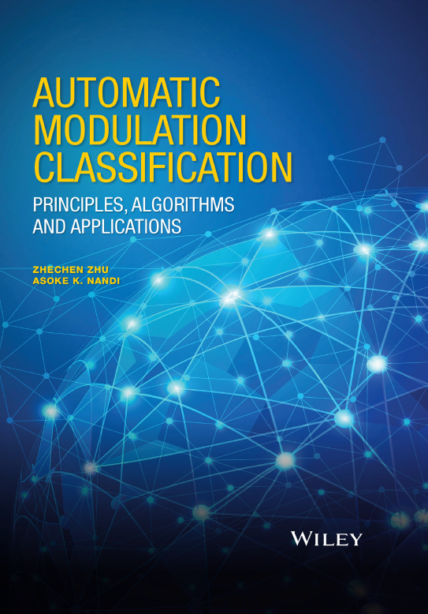

# **Book Recommendation**: Automatic Modulation Classification

For decades, Automatic Modulation Classification (AMC) has been a key technology in many military, security, and civilian telecommunication applications. In military and security applications, modulation is often used as another level of encryption; in modern civilian applications, signal transmitters can utilize various modulation types to control data rates and link reliability.
This book provides comprehensive documentation on the AMC model, algorithms, and implementations for successful modulation recognition. It offers valuable theoretical insights and numerical comparisons of the AMC algorithms, and provides guidance for the latest classification design considerations for specific military and civilian applications.
Key Features:
- Offers five major categories of important AMC algorithm collections, ranging from probabilistic classifiers and distribution testing classifiers to feature-based classifiers, machine learning-assisted classifiers, and blind modulation classifiers.
- Lists each algorithm's detailed implementation based on a unified theoretical background and comprehensive theoretical and numerical performance comparisons.
- Provides clear guidance for the design of specific automatic modulation classifiers for different practical applications in civilian and military communication systems.
- Includes a MATLAB toolbox on the accompanying website, providing implementations of the methods discussed in this book.

## Images

<!-- PAYMENT_BLOCK -->

## Get this dataset

- Payment link (Stripe): [Buy now](https://buy.stripe.com/3cs8yP7sY87d0vu9AB)
- Payment QR code: 

<!-- /PAYMENT_BLOCK -->
